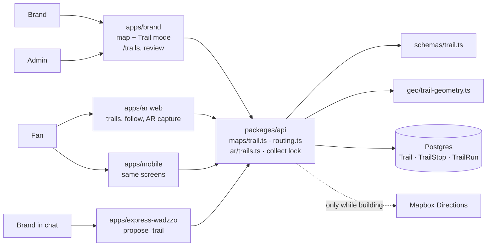

# Map Trails

> **Status: plan, not built.** Items marked **(confirm)** wait on the client's answers (see [Open questions](./delivery.md#open-questions)).

A **trail** is an ordered set of a brand's pins, plus the path between them. Brands build trails on the map they already use. Fans follow a trail stop by stop, collect each pin the way they do today (AR capture, auto-collect or QR), and claim a reward when they finish.

```
 Today                 Brand builds a trail            Fan completes it
 ─────                 ────────────────────            ────────────────
  ○      ○              ①━━━━━②                         ━━━━━━━━━━━━ 4/4
     ○        ──►            ┃              ──►          🏆 reward claimed
  ○                          ③━━━━━④
 separate pins          same pins, ordered + path
```

**Key principle: nothing about collecting changes.** A trail stop _is_ an existing pin (`LocationGroup`). Collecting, auto-collect, limits, claims and redeem codes stay as they are. A trail only adds order, a path line, progress and an optional finishing reward.

## Documents

| Doc                                                    | What it covers                                                                                                                |
| ------------------------------------------------------ | ----------------------------------------------------------------------------------------------------------------------------- |
| [Brand & admin experience](./brand-and-admin.md)       | Trail mode on the existing map, adding stops, **the New stop form (pin shape, look, settings)**, the brand flow, admin review |
| [Fan experience & collecting](./fan-and-collecting.md) | Discover, follow, **AR capture / auto-collect / QR on a trail**, order lock, progress, reward                                 |
| [Data model & API](./data-and-api.md)                  | `Trail`, `TrailStop`, `TrailRun`, lifecycle, tRPC procedures, server logic                                                    |
| [Map layer](./map-layer.md)                            | How trail lines and numbered stops are drawn (web and mobile)                                                                 |
| [AI](./ai.md)                                          | The map agent's trail tools, the ✦ Assist button, what AI must not decide                                                     |
| [Delivery](./delivery.md)                              | Module map, phases, edge cases, open questions                                                                                |

## Words used

| Term              | Meaning                                                                                                     |
| ----------------- | ----------------------------------------------------------------------------------------------------------- |
| **Trail**         | A brand's named route: title, cover, activity (walk / bike / drive), dates, colour, rules, optional reward. |
| **Stop**          | One pin on the trail, with its number (①②③). A pin can be on several trails.                                |
| **Section**       | The path between two stops in a row: _snapped to paths_ (follows real roads and footpaths) or _straight_.   |
| **Trail mode**    | The editing mode on the existing brand / admin map, like today's "Draw hotspot" mode.                       |
| **Stop defaults** | Settings set once per trail (look, type, dates, collection) that every new stop starts from.                |
| **Run**           | One fan's attempt at a trail: started, finished, reward claimed.                                            |
| **Order**         | _In order_: the next stop unlocks after the previous one is collected. _Any order_: collect in any order.   |

## Recommended defaults (confirm)

| Question                         | Recommended                                                                               | If the client chooses otherwise               |
| -------------------------------- | ----------------------------------------------------------------------------------------- | --------------------------------------------- |
| Where trails are built           | On the **existing brand map and admin map** as a Trail mode, plus a `/trails` list        | A separate page reuses the same components    |
| Stop order                       | **Brand chooses per trail**, default In order                                             | One fixed mode: remove the switch             |
| Path                             | **Snap to paths** by default; any section can be straight; bends draggable                | Straight lines only: no routing calls         |
| Finishing reward                 | **Optional** asset reward through the existing claim path; all required stops or "N of M" | No reward: progress only                      |
| Which pins can be stops          | **Regular pins of the same brand**, not hotspot drops                                     | Hotspot stops need a "which drop counts" rule |
| One pin on many trails           | **Yes**; one collect counts for every trail                                               | Make it unique                                |
| Approval                         | **Same as pins**: admin approves; text/colour edits skip review                           | Publish goes live directly                    |
| Admin builds for which brand     | **The first stop decides** the brand                                                      | A "Build for brand…" picker                   |
| Locked stop in an In-order trail | **Can't be collected** until the previous one is                                          | Collectable, only progress waits              |
| Collect method                   | **Each pin keeps its own** (AR / auto / QR); optional "AR only" per trail                 | Force one method                              |

## Research: what others do

| Product                                     | How their trails work                                                                                                                                              | What we borrow                                                 |
| ------------------------------------------- | ------------------------------------------------------------------------------------------------------------------------------------------------------------------ | -------------------------------------------------------------- |
| **AllTrails** route builder (reviewed live) | Side panel + full map; live length / elevation / time; "Snap to paths"; undo/redo, close loop, double back, reverse; Segments and Waypoints tabs; direction arrows | Builder layout, map toolbar, live stats, arrows, snap/straight |
| **Bandwango** digital passports             | Venues on a branded passport (Oakland Ale Trail, Cleveland Brewery Passport); GPS or PIN check-ins; rewards                                                        | The business model: branded check-in trail with a reward       |
| **Geocaching Adventure Lab**                | Creator picks fixed order or free play; the next stage stays locked                                                                                                | In order / Any order, locked next stop                         |
| **Pokémon GO Routes**                       | Routes between points of interest, recorded by walking, reviewed before going live; 500 m+ advised                                                                 | Review before publish; later, record a path by walking         |
| **Strava / Komoot**                         | Click points, the route follows roads; any stretch can be hand-drawn                                                                                               | Snap per section with manual fallback                          |

The difference: an AllTrails route is _a line with notes_. A Wadzzo trail is a line whose stops are _collectibles with progress and a reward_, so the builder puts the **Stops** list at its centre.

Sources: [AllTrails route](https://www.alltrails.com/explore/custom-routes/trail/bangladesh/dhaka/chondrima-uddan-loop) · [Bandwango](https://www.bandwango.com/resources/what-makes-bandwango-unique) · [Oakland Ale Trail](https://ftnnews.com/?p=13254) · [Adventure Lab](https://www.geocaching.com/sites/adventure-lab/) · [Adventure Lab FAQ](https://www.geocaching.com/blog/2018/12/geocaching-adventure-lab-app-faq/) · [Pokémon GO Routes](https://pokemongo.com/routes) · [Mapbox Directions](https://docs.mapbox.com/api/navigation/directions)

## System overview



Mapbox is called from the server only, so the token stays private and fans never trigger routing.
