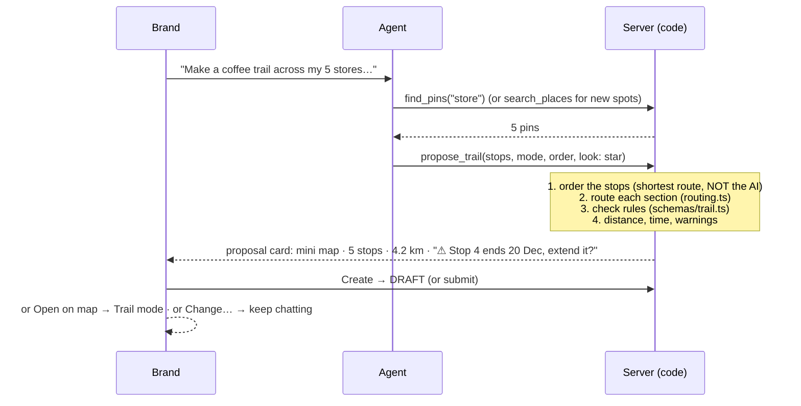

# Trails: AI

[← Map Trails](./README.md)

AI joins trails the way it already works for pins. **AI only proposes; the brand confirms; the server checks with the same rules as the builder.** Ordering, routing and progress are plain code, not AI.

## What exists today

The map assistant runs in `apps/express-wadzzo/src/agent`: a LangChain agent on an OpenAI model (`AGENT_MODEL`) with these tools:

- **Find:** `search_places` (Google), `search_web_list`, `find_pins`, `find_hotspots`, `locate`
- **Report:** `collection_report`, `collectors`
- **Propose:** `propose_pins`, `propose_hotspot`, `propose_pin_changes`, … These return a **proposal card**; on Confirm, `packages/api/src/brand/server/agent/actions.ts` carries it out.
- **Talk:** `ask_user`, `show_results`

The system prompt already says to use `search_web_list` "for a named collection: an artist's works, **a trail**, a series". Separately, `packages/api/src/brand/server/ai/` holds direct model calls (`TEXT_MODEL`, `IMAGE_MODEL`), used by Pin Studio's silhouettes.

## 1. Create a trail by chat

> "Make a coffee trail across my 5 Dhaka stores, star pins, in order, walking"



- The AI chooses **which** stops; `orderStops()` in `packages/geo` chooses the **order**. Language models are unreliable at geometry.
- New places become new pins and the trail in **one transaction**. The agent's `look` sets the trail's **Stop defaults**, so the New stop form and the agent agree.
- When the request is unclear ("which stores?"), the agent asks with `ask_user`, as it does for pin shapes.

More examples:

- "Find 6 street-art murals in Gulshan and make a trail" → `search_web_list` → new pins plus a trail.
- "Make a Christmas trail from my December pins" → `find_pins` filtered by date → `propose_trail`.

## 2. Change trails by chat

"Add my new Banani store as stop 3" · "Make the art walk shorter than 3 km" · "Make it a loop" · "End the holiday trail early"

These use the tools `list_trails` and `propose_trail_changes`, which return a before/after card for the brand to confirm.

## 3. Ask how a trail is doing

> "Why do people quit my coffee trail?"

`trail_report` (next to `collection_report`) returns per-stop figures: 412 started → 380 at stop 2 → **190 at stop 3** → 128 finished. The agent explains them in plain language:

> "Half of fans drop off between stop 2 and stop 3. It's the longest gap (1.4 km), and stop 3 only collects when tapped. Add a stop in between, or switch stop 3 to auto-collect?"

It then offers that fix as a proposal card.

## 4. ✦ Assist inside Trail mode (no chat)

A button in the Trail mode panel, like Pin Studio's "Enhance with AI":

| Action                       | Done by              | How                                                                                        |
| ---------------------------- | -------------------- | ------------------------------------------------------------------------------------------ |
| **Best order**               | Code                 | `orderStops()`; shows the distance before and after                                        |
| **Name & description**       | AI                   | `TEXT_MODEL` with the stops, area and brand bio; 3 options                                 |
| **Clue for each stop**       | AI                   | Short hints ("Find the blue door by the lake"), optional                                   |
| **Fill a gap**               | AI + `search_places` | Suggests a place between two far-apart stops; it opens in the New stop form                |
| **Cover image**              | AI                   | `IMAGE_MODEL`, the same setup as Pin Studio silhouettes                                    |
| **Stop image / description** | AI                   | The pin form's existing AI image and `EnhanceDescriptionButton`, also in the New stop form |

These live in `packages/api/src/brand/server/ai/trail-assist.ts` and don't need the chat agent.

## 5. Fan side

No AI is needed in the MVP. A possible later option: AI-written **story text per stop** that appears when a fan collects it, chosen by the brand.

## What AI must not decide

| Task                                               | Why it stays code                                  |
| -------------------------------------------------- | -------------------------------------------------- |
| Stop order and routing                             | Must be correct and repeatable                     |
| Whether a stop can be collected, progress, rewards | Assets and money; must be exact and auditable      |
| Saving anything                                    | AI proposes; the brand confirms; the server checks |

## What gets added (Phase 2)

```
packages/agent-contract             + TrailProposal, TrailChangeProposal, "trail-report" block
apps/express-wadzzo/src/agent/tools + list_trails, propose_trail, propose_trail_changes, trail_report
apps/express-wadzzo/src/agent/prompt.ts  + "for a trail, gather the stops, then call propose_trail"
packages/api/src/brand/server/agent/actions.ts  + carry out trail proposals
packages/api/src/brand/server/ai/trail-assist.ts + names, descriptions, clues, cover image
packages/geo                        + orderStops()
apps/brand/src/features/agent/cards + trail proposal card (mini map), trail report card
apps/brand/src/features/trails      + ✦ Assist button
```
