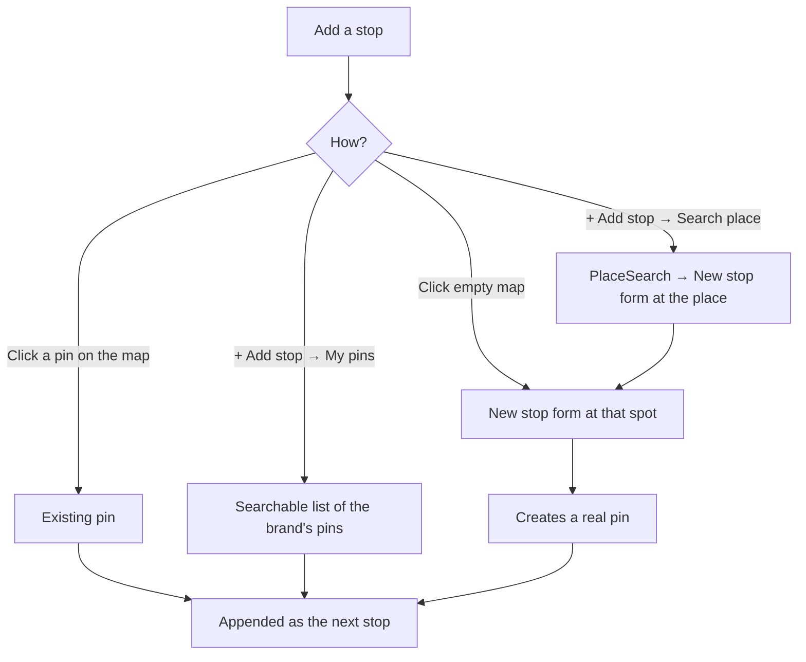
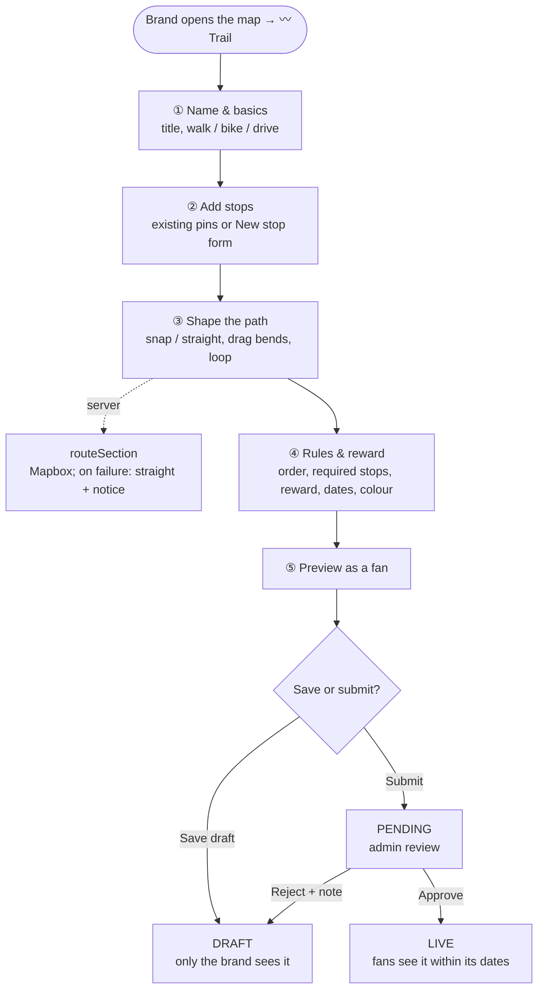

# Trails: brand & admin experience

[← Map Trails](./README.md)

No new map. The brand map (`apps/brand/src/features/pins/map-view.tsx`) and the admin map (`features/admin/maps-page.tsx`) get a **Trail mode**, the same way they already have "Draw hotspot" (`drawing`), template placing (`placing`) and copy/cut paste modes. Both maps share the same `TrailMode` and `TrailLayer` components.

## The map, normal mode

```
┌──────────────────────────────────────────────────────────────────────────────┐
│ [🔍 Search place] [◐ Show expired] [◉ Trails]  [Templates ▾] [⬡ Hotspot] [〰 Trail] [+ New pin] │
│                                                                              │
│        ①━━━━━━②                         ①┄┄┄②   ← draft trail (dashed)       │
│                 ╲                              ┆                             │
│                  ③        ○   ○                ③                             │
│        ┌───────────────────────────┐                                         │
│        │ ▢ Coffee Trail      LIVE   │  ← click a line                         │
│        │   3 stops · 2.4 km · 35 min│                                         │
│        │   412 started · 128 done   │                                         │
│        │   [Edit] [Stats] [⋯]       │                                         │
│        └───────────────────────────┘                                         │
└──────────────────────────────────────────────────────────────────────────────┘
```

- **◉ Trails** toggle shows or hides trail lines (next to "Show expired").
- **〰 Trail** starts a new trail in Trail mode.
- Clicking a line opens the **trail card**.

### Ways into Trail mode

| From                                                            | What happens                                                                                            |
| --------------------------------------------------------------- | ------------------------------------------------------------------------------------------------------- |
| **〰 Trail** button                                             | An empty trail. The first stop added becomes ①.                                                         |
| Trail card → **Edit**                                           | The trail opens with its stops and path.                                                                |
| Pin details window → **Add to trail…** / **Start a trail here** | Adds this pin to a chosen trail, or starts a new one with it as ①. The window also shows "On 2 trails". |
| `/pins/trails` list → **New** / **Edit**                            | Opens the map in Trail mode with that trail.                                                            |
| AI chat → **Open on map**                                       | A proposed trail opens as a draft (see [AI](./ai.md)).                                                  |

## Trail mode (desktop)

```
┌─────────────────────────┬──────────────────────────────────────────────────┐
│ ← Coffee Trail ✎  DRAFT │      ┌──────────────────────────────────────────┐ │
│ 2.4 km · 35 min · 🚶 ▾   │      │ Click a pin to add it · click empty map   │ │
│ [ In order | Any order ]│      │ for a new stop                            │ │
│                         │      └──────────────────────────────────────────┘ │
│ Stops (4)  Details  Reward│          ①━━○━━②━━━━③                      ◌    │
│ ┌─────────────────────┐ │                         ╲                (dimmed │
│ │⠿ ① Main store    ✕ │ │                          ○                pins:  │
│ │⠿ ② Kiosk         ✕ │ │                           ╲              other   │
│ │   ↳ 0.9 km · snapped │ │                            ④┄┄┄⊕  ← new stop   brand/ │
│ │⠿ ③ Café          ✕ │ │                                       expired) │
│ │   ↳ 0.4 km · straight│ │                                                  │
│ │⠿ ④ Park stand    ✕ │ │                                                  │
│ │ + Add stop           │ │  ┌────────────────────────────────────────────┐ │
│ └─────────────────────┘ │  │ ◉ Snap to paths  ↶ ↷  ⟲ Close loop  ⇄ Reverse  ⤢ Fit │ │
│ [Save draft] [Submit ›] │  └────────────────────────────────────────────┘ │
└─────────────────────────┴──────────────────────────────────────────────────┘
```

While Trail mode is open, search and the nearby-locations panel are hidden. Hotspot areas stay visible but can't be clicked. Pins that can't join (another brand's, expired or hidden) are dimmed.

| Action                                  | Result                                                                                                                                                                                                                    |
| --------------------------------------- | ------------------------------------------------------------------------------------------------------------------------------------------------------------------------------------------------------------------------- |
| Click a bright pin                      | It becomes the next stop; it gets a number badge and the line extends to it. If its look differs from the trail's style, the brand is asked whether to switch it (see [Existing pins as stops](#existing-pins-as-stops)). |
| Click empty map                         | The **New stop** form opens at that spot (see below).                                                                                                                                                                     |
| Drag ⠿ in the list                      | Reorders stops; numbers and the line update live. Only the affected sections are re-routed.                                                                                                                               |
| Drag a ○ bend point                     | Reshapes that section by hand (it becomes "custom").                                                                                                                                                                      |
| Click "snapped / straight" under a stop | Switches that one section.                                                                                                                                                                                                |
| ✕ on a stop                             | Removes it from the trail. **The pin is not deleted.**                                                                                                                                                                    |
| ↶ ↷                                     | Undo / redo (same pattern as Pin Studio's `use-shape-history`).                                                                                                                                                           |
| ⟲ Close loop · ⇄ Reverse                | Joins the end back to ①, or reverses the order.                                                                                                                                                                           |
| Esc / ← with changes                    | "Keep your draft?" Drafts are also saved locally, so a reload loses nothing.                                                                                                                                              |

### Panel tabs

| Tab         | Contents                                                                                                          |
| ----------- | ----------------------------------------------------------------------------------------------------------------- |
| **Stops**   | The ordered stop list, as above.                                                                                  |
| **Details** | Title, description, cover image, activity, dates, line colour, **Stop defaults** (see below).                     |
| **Reward**  | Optional finishing reward: asset, how many can claim, "all required stops" or "N of M", which stops are optional. |

## Adding stops

There are four ways, all ending in the same stop list:



## The New stop form: pin shape, look and settings

When a brand clicks empty map (or picks a searched place), they don't leave the map for the full `/pins/new` page. A **New stop** form opens inside the Trail mode panel. It is **the same pin form**, built from the same pieces, so stops are normal pins with every normal option:

- the same form schema and validation (`createPinFormSchema` in `components/pins/pin-form-parts.tsx`);
- the same sections (`ImageUploadField`, `PinLookSection` with the shape picker, `CollectionInputs`, `TiersOptions`, `PinTypeToggles`, `TagsSection`);
- the same save call (`api.maps.pin.createPin`).

The difference is the **layout**: only what changes from stop to stop is open; everything else starts from the trail's **Stop defaults** and is folded away.

**Decided:** every new stop opens this short form. The style and settings are already filled in from the trail's Stop defaults, so the brand normally types a title and clicks **Add stop**. Because the form opens each time, any section can also be changed for that one stop.

### Desktop: the panel swaps to the form

```
┌─────────────────────────────┐
│ ← Back to stops   New stop ⑤ │      map: the new marker is drawn live
│─────────────────────────────│      in the chosen shape, with badge ⑤,
│ Title *                      │      and can be dragged to move it
│ [ Riverside kiosk          ] │
│                              │              ①━━②━━③━━④┄┄┄⑤ ★
│ Image                        │
│ [ ▢ upload ] [✦ AI image]    │
│   (empty = brand logo)       │
│                              │
│ ▸ Pin look      ★ Star · logo│  ← collapsed; shows the trail default
│   ┌────────────────────────┐ │
│   │ ○ ▢ ⬡ ⛉ ★ 💧 + my shapes│ │  ← opened: the existing PinLookSection
│   │ Fill: Brand│Pin│None    │ │     (shape picker, fill, colour, fit,
│   │ Colour ● ● ● ●          │ │      ⚡ badge), the same as /pins/new
│   └────────────────────────┘ │
│                              │
│ ▸ Collection       Tap · 100 │  ← collapsed: auto/tap, limit, tier
│ ▸ Dates     same as the trail│  ← collapsed: follows the trail's dates
│ ▸ Details & tags   Type: Shop│  ← description, link, type, tags
│                              │
│ Open full pin form ↗         │  ← escape hatch (see below)
│─────────────────────────────│
│ [Cancel]      [Add stop ⑤ ✓] │
└─────────────────────────────┘
```

- **Required:** title only. The location is where they clicked; the image falls back to the brand logo.
- **Each collapsed row shows its current value** ("★ Star · logo", "Tap · 100"), so the brand can see what the stop will be without opening anything.
- **Live preview on the map:** the new marker is drawn with the chosen shape and look, the ⑤ badge and its line section, and can be dragged.
- **Add stop** creates the pin and appends it as the next stop. On a phone, the bottom sheet expands to full height with the same sections.

### Stop defaults: set the look once for the whole trail

In the **Details** tab, _Stop defaults_ holds the values every new stop starts from:

| Default                                  | Example                          | Reuses                                                                  |
| ---------------------------------------- | -------------------------------- | ----------------------------------------------------------------------- |
| Pin look (shape, fill, colour, ⚡ badge) | ★ Star, brand logo, green        | `PinLookEditor` + shape picker, including the brand's Pin Studio shapes |
| Collection                               | Tap to collect, 100 per pin      | `CollectionInputs`                                                      |
| Tier / who can collect                   | Everyone                         | `TiersOptions`                                                          |
| Dates                                    | Follow the trail's start and end | —                                                                       |
| **Or start from a template**             | "Coffee stop" template           | `TemplatePicker` (pin templates)                                        |

Changing a default fills in **stops created after the change**. For stops already on the trail, the brand is asked: "Update the look of all 8 stops to ★ Star?" The dialog lists the pins it will change, because a pin may also be on another trail or stand alone on the map. **Keep them** leaves those pins as they are.

### The full pin form, when needed

**Open full pin form ↗** goes to `/pins/new?lat=…&lng=…&trail=<draftId>`, the existing page with everything open. On save it returns to the map in Trail mode with the new pin added as the next stop. The trail draft is kept, so nothing is lost.

### Existing pins as stops

**Decided:** when a brand adds a pin that's already on the map and its look differs from the trail's style, the brand is asked:

```
Add "Café" to Coffee Trail
┌──────────────────────────────┐
│ Use the trail's style?        │
│  now: ● Circle  →  ★ Star     │
│ This changes the pin          │
│ everywhere it appears.        │
│ [Keep its look] [Use ★ Star]  │
└──────────────────────────────┘
```

- **Use ★ Star** changes the pin's look columns (shape, fill, colour, ⚡ badge) through the normal pin update, so the pin looks like that everywhere, including on other trails and on the main map.
- **Keep its look** leaves the pin as it is; the trail adds only the number badge and the line.
- No question is asked when the pin already matches the trail's style.
- Only the **look** is offered. Collection settings, dates and tier stay the pin's own, because changing them could affect fans already collecting it.
- On a live pin, the look change goes live at once, like any pin edit.

To change anything else on an existing stop, click it → **Edit pin**, which opens the existing pin details window.

A later improvement, not planned now: draw stops in the trail's style **only while a fan is following the trail**, so the pin itself never changes.

### Approval of new stops

Pins created from the New stop form follow the normal pin rules (`approved` on `LocationGroup`). When the trail is submitted, its new pins appear in the same review, so the admin approves the trail and its new pins together.

## The brand flow, start to live



Steps ①–⑤ are tabs, not a forced wizard: a brand can jump between them at any time.

### Rules the builder enforces

These are shown inline as the brand works, never as surprise errors on save. The same rules in `packages/schemas/src/trail.ts` run in the browser and on the server.

- At least **2 stops** to save or submit; recommended maximum **25**.
- All stops belong to the **same brand** and are **not hidden or expired**.
- The trail's dates must **fit inside its stops' dates**; a warning offers "extend pin end dates".
- Stops too far apart for the activity (e.g. 40 km walking) → a soft warning.
- A reward needs an asset and a limit.

## Phone

The panel becomes a draggable **bottom sheet** (peek / half / full) over the map:

```
┌───────────────────────┐
│ ✕   Coffee Trail  Save│
│                       │
│   ①━━━━━②             │
│          ╲            │   map stays visible
│           ③           │
│╭─────────────────────╮│
││        ───          ││   ← drag handle
││ 2.4 km · 35 min · 🚶 ││
││ [In order|Any order] ││
││ ① Main store      ⠿ ││
││ ② Kiosk           ⠿ ││
││ ③ Café            ⠿ ││
││ [↶ ↷ ⋯] [+ Add stop] ││
│╰─────────────────────╯│
└───────────────────────┘
```

## Other brand screens

**Pin details window (existing):** two additions.

```
┌──────────────────────────────────────┐
│ ▢  Café pin                           │
│    Ends 30 Nov · 128 collected        │
│    [〰 On 2 trails ▾]                  │
│ Edit · Copy · Move · Hide             │
│ [〰 Add to trail…] [Start a trail here]│
└──────────────────────────────────────┘
```

**`/pins/trails` list page** (Drops › Trails in the sidebar):

```
┌──────────────────────────────────────────┐
│ Trails                       [+ New trail]│
│ All (5) · Live 2 · Pending 1 · Drafts 2   │
│ ▢ Coffee Trail    4 stops · 2.4 km  LIVE  │
│ ▢ Riverside Art   6 stops · 3.1 km PENDING│
│ ▢ Holiday Hunt    2 stops          DRAFT  │
└──────────────────────────────────────────┘
```

Each row opens the map in Trail mode. **Stats** shows how many started and finished, and the **drop-off per stop** (where fans give up).

## Admin

The admin map uses the same Trail mode and layer. Two things differ:

**1. Building for a brand.** The admin map shows every brand's pins. **The first stop decides the brand** **(confirm)**: after that, only that brand's pins stay clickable, and a banner reads "Building for Brew Co. (from stop 1)". The trail is saved with that brand as its owner, so it appears in the brand's `/pins/trails` list. New stops created here belong to that brand too.

**2. Reviewing trails.** "Admin › Trails to review" follows the existing pin review pattern (`getReviewGroup`):

```
┌──────────────────────────────────────────────┐
│ Admin › Trails to review (3)                  │
│ ┌──────────┐ Riverside Art Walk               │
│ │ mini map │ Brew Co. · 6 stops · 3.1 km      │
│ │  ╭──╮    │ Reward: 200 × Art Badge          │
│ └──────────┘ ⚠ stop 4 ends before the trail   │
│              [Approve] [Reject] [Map]          │
│ Holiday Hunt · Sweet Shop · 3 stops            │
└──────────────────────────────────────────────┘
```

Reject asks for a note, which the brand sees on its draft. If "admin from the brand" means the **brand's own team** rather than platform admins, they use the brand map with the brand's permissions and neither difference applies. **(confirm)**
