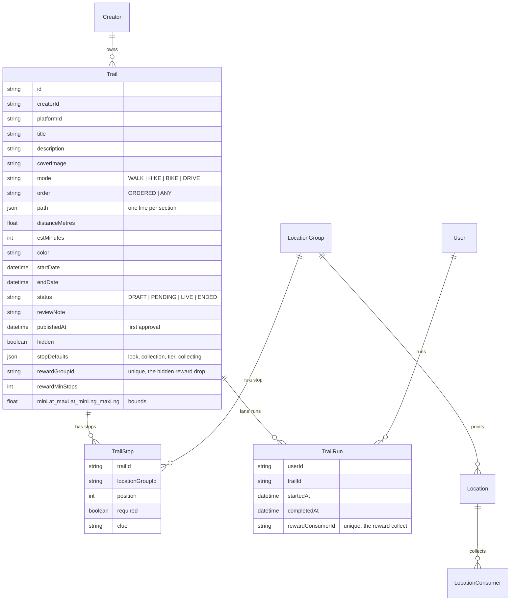
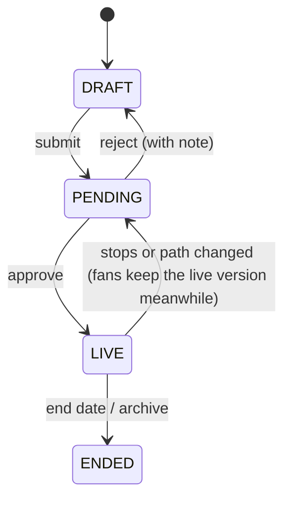

# Trails: data model & API

[← Map Trails](./README.md)

## Data model: three new tables

Nothing existing changes. The migration is one additive SQL file (`packages/db/prisma/sql/2026-11-10-trails.sql`), safe to run twice, the same style as the pin-look migrations.

Constraints and indexes:

- `TrailStop`: `@@unique([trailId, position])`, `@@unique([trailId, locationGroupId])`; deleting a pin cascades its stops.
- `TrailRun`: `@@unique([userId, trailId])`; `rewardConsumerId` unique.
- `Trail`: `@@index([creatorId, status])`, `@@index([platformId])`, `@@index([status, minLat, maxLat])`; `rewardGroupId` unique.

Why it's shaped this way:

- **Stops point to pins (`LocationGroup`)**, so every collecting rule stays in one place.
- **The path is saved** when the brand saves (one GeoJSON line per section), so viewing a trail never calls Mapbox.
- **Progress isn't stored:** it's computed from `LocationConsumer`, so there's no counter to drift.
- **`TrailRun` stores only milestones:** started, finished, reward claim.
- **`minLat`…`maxLng`** make "trails in view" a cheap query, like pins.
- **The reward is a hidden drop.** `rewardGroupId` points to a `LocationGroup` (asset, limit, remaining) whose single `Location` is `hidden`, so it never shows on a map. Claiming it writes an ordinary `LocationConsumer` (`TrailRun.rewardConsumerId`), so stock, redeem codes and _Claim to wallet_ (`claim.forPin`) work exactly as for any pin.
- **`stopDefaults`** holds the values the New stop form starts from (see [brand doc](./brand-and-admin.md#stop-defaults-set-the-look-once-for-the-whole-trail)). It uses the same shapes as `@wadzzo/schemas/pin-look` and pin templates.
- **Every table has `platformId`**, for white-label platforms, as pins do.

## Lifecycle

- While an edit to a live trail is in review (`PENDING` with `publishedAt` set), fans keep seeing it, so a trail never disappears mid-run.
- A trail's stops stay off the fan map until it's approved: any pin that is a stop of a `DRAFT` or never-approved `PENDING` trail is left out of `pins.list` / `search` / `byBrand` and can't be claimed, unless it is also a stop of a live trail (`trailApprovalGate` in `packages/api/src/ar/server/trails.ts`). A fan who already collected it can still open its card.
- Send back (reject) returns it to `DRAFT` with the note; delete is only possible before any fan has started it.
- Text, cover and colour edits go live at once.

## API (tRPC)

| Router                                                         | Procedures                                                                                                                                                                                                                                                                                                  |
| -------------------------------------------------------------- | ----------------------------------------------------------------------------------------------------------------------------------------------------------------------------------------------------------------------------------------------------------------------------------------------------------- |
| `packages/api/src/brand/routers/maps/trail.ts` (brand + admin) | `list` · `listInView(bounds)` · `get(id)` · `save` (create/update; stops + path + defaults + reward in one call) · `routeSection(mode, points)` · `submit` · `archive` · `delete` (no runs yet) · `applyStyle(pinIds, look)` · `assist` (✦ title, description, clues) · `stats(id)` · `trailsForPin(pinId)` |
| same router (admin only)                                       | `reviewQueue` · `approve(id)` · `reject(id, note)`                                                                                                                                                                                                                                                          |
| `packages/api/src/ar/routers/trails.ts` (fans)                 | `nearby(lat, lng, radiusKm)` (nearest first; radius up to 20 000 km, the web list asks for all) · `inArea(north, south, east, west)` (the map's lines, wherever it looks) · `get(id)` (with my progress) · `mine` · `start(id)` · `claimReward(id)` → `{ pinId, redeemCode }`                               |
| `packages/api/src/ar/routers/pins.ts` (existing)               | `assertClaimable` + order lock (`ar/server/trails.ts`) · `TrailRun` started/finished after a collect. Response shapes are unchanged; the apps read progress from `trails.get`                                                                                                                               |
| `apps/ar/src/app/api/mobile/v1`                                | **New** routes: `GET /trails`, `GET /trails/mine`, `GET /trails/:id`, `POST /trails/:id/start`, `POST /trails/:id/claim-reward` (`packages/api/src/ar/mobile/routes.ts`). Existing mobile contracts are not changed (see `apps/ar/AGENTS.md`).                                                              |

New stops created from Trail mode use the **existing** `api.maps.pin.createPin`. No second way of creating pins.

**One save call, not many.** The builder holds the whole trail locally, with undo/redo, and sends it in one `save`. The server checks it with `schemas/trail.ts` and writes stops, path and defaults in one transaction, so there are no half-saved trails. An `updatedAt` check stops two people overwriting each other.

## Server pieces

| File                                       | Job                                                                                                                                         |
| ------------------------------------------ | ------------------------------------------------------------------------------------------------------------------------------------------- |
| `packages/api/src/brand/server/trails.ts`  | Save, validate, submit, approve; brand ownership; date checks against stops                                                                 |
| `packages/api/src/brand/server/routing.ts` | Mapbox Directions per section (walking / cycling / driving), server-side token, cached per pair of points; failure → straight line + notice |
| `packages/schemas/src/trail.ts`            | Input rules, limits (2–25 stops), `trailProgress()`                                                                                         |
| `packages/geo/src/trail-geometry.ts`       | Length, bounds, joining sections, simplify, `trailsToFeatures()`, `orderStops()`                                                            |

Mapbox Directions accepts up to 25 coordinates per walking request, so routing one section (two stops plus bends) at a time stays well within the limit.
