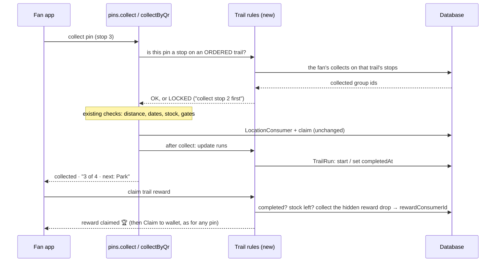

# Trails: fan experience & collecting

[← Map Trails](./README.md)

Fans use the AR web app (`apps/ar`) and the mobile app (`apps/mobile`); both get the same trail screens.

## The four screens

```
 1 · Discover            2 · Trail page           3 · Follow mode            4 · Finish
┌───────────────┐       ┌───────────────┐        ┌───────────────┐         ┌───────────────┐
│Pins Trails● You│       │ ← [cover]      │        │Coffee Trail  ✕ │         │      🏆        │
│  ╭─╮   ╱╲     │       │ Coffee Trail   │        │━━━━━━░░░░ 2/4  │         │Trail complete! │
│ map with lines│       │ by Brew Co.    │        │   ✓━━✓┄┄③┄┄🔒  │         │Coffee · 4/4    │
│───────────────│       │ 2.4km 35min 4  │        │      ● you     │         │ ▢ Art Badge    │
│Trails near you│       │ [mini map]     │        │────────────────│         │  your reward   │
│▢ Coffee Trail │       │ In order       │        │Next · 3 of 4   │         │[Claim reward]  │
│  2.4 km · 🏆   │       │ ① Main store   │        │Café            │         │Share · More    │
│▢ Art Walk     │       │ ② Kiosk ③ Café │        │350 m · 4 min ↗ │         └───────────────┘
│  2 / 6 done   │       │ 🏆 72/200 left  │        │[Directions]    │
└───────────────┘       │ [Start trail]  │        │[📷 Capture in AR]│
                        └───────────────┘        └───────────────┘
```

1. **Discover:** a Trails tab and trail lines on the map, showing distance away and the fan's progress.
2. **Trail page:** map, stats, stops, rules, reward, and **Start trail**.
3. **Follow mode:** collected stops are ticked and drawn solid; the next stop is highlighted; locked stops are grey with 🔒. The progress bar sits at the top.
4. **Finish:** a celebration, then **Claim reward** (it goes to the wallet like a pin claim).

## How collecting works today

A trail adds no new way to collect. These are the three that exist:

| Method                        | What the fan does                                                                                                                                                             | Server check                                                                                                |
| ----------------------------- | ----------------------------------------------------------------------------------------------------------------------------------------------------------------------------- | ----------------------------------------------------------------------------------------------------------- |
| **AR capture** (the main one) | Map → **"Capture in AR"** opens the camera at `/ar?target=<pin>`. The pin floats where it is in the world; the fan turns toward it, aims the reticle and presses **Collect**. | `pins.collect`: within **75 m** (`AR_CAPTURE_RADIUS` in `ar-core`) plus 40 m GPS slack (`GEOFENCE_SLACK_M`) |
| **Auto-collect**              | With the setting on, pins marked auto-collect are collected automatically within 75 m, one at a time about 1.2 s apart (`app/(shell)/map/page.tsx`).                          | Same `pins.collect`                                                                                         |
| **QR scan**                   | Scan the pin's printed QR code at `/scan`. Works indoors with no GPS.                                                                                                         | `pins.collectByQr`: no distance check; holding the code is the proof                                        |

The map's "Capture in AR" deliberately does **not** collect on the spot: the app's point is pointing the phone at the world. Trails keep that.

The AR is location-based: pins are placed by GPS and compass over the camera view, with no ARKit/ARCore world tracking. That's fine for trails, because stops are tens of metres apart.

## Collecting a trail stop

```
FOLLOW MODE (map)              AR CAMERA (/ar?target=stop3)              RESULT
─────────────────              ────────────────────────────              ──────
Next · 3 of 4 · Café           ┌──────────────────────────┐             ✓ Stop 3 of 4
350 m ↗                        │ ◀ ② ✓    Café ③ 350 m ▶   │ ← compass   ━━━━━━━━░░ 3/4
                               │                            │             Next: Park stand
[📷 Capture in AR] ──────────► │          ( ③ )  ← reticle  │ ──────────► 600 m →  [Follow]
                               │  🔒 ④ (locked, greyed)     │
 walk until within 75 m        │         [ COLLECT ]        │             last stop →
                               └──────────────────────────┘             🏆 Trail complete
```

What the trail **adds** to the AR camera:

1. **Trail labels on pins in AR:** the next stop shows its number and trail colour; collected stops show ✓; locked stops are grey with 🔒 and can't be captured. Tapping a locked stop shows "Collect stop 2 (Kiosk) first".
2. **A next-stop marker on the compass strip** ("Café · 350 m"), even before the stop is within 75 m.
3. **After a capture:** the usual capture animation, then a trail card ("Stop 3 of 4 ✓ · Next: Park stand, 600 m →") with a button back to follow mode. The last stop opens the **Trail complete** screen.

The other two methods on a trail:

- **Auto-collect** works only for stops the brand marked auto-collect. The client-side loop **skips locked stops**, so it doesn't hit the server or show error toasts.
- **QR** suits **indoor stops** (inside a shop or mall). It counts toward the trail like any other collect.

### Optional per-trail setting (confirm)

**"Collect stops in AR only"** turns off auto-collect for the trail's stops, so fans open the camera at each one; this suits treasure hunts and story trails. QR stays allowed for indoor stops. The default is **off**: each pin keeps its own setting.

## What happens on the server



- **The order lock lives in `assertClaimable`**, which `pins.collect` and `pins.collectByQr` both run. Put once there, AR, auto-collect, QR, web and mobile all obey it.
- **Completion is set in the same transaction as the collect**, so a quick double-collect can't skip it.
- **The reward claim** collects the trail's hidden reward drop with the same code as a pin collect (`writeClaimRow`). `rewardConsumerId` is unique (claimed once), stock goes down the same way pin limits do, and the item reaches the wallet through the existing _Claim to wallet_.
- **Pins collected before the trail existed count too** (the fan starts ahead).
- Collecting any stop of a trail the fan hasn't started **starts it automatically** ("You started Coffee Trail").

### Progress: one shared function

```ts
trailProgress(stops, collectedGroupIds) → {
  done: [1, 2], next: 3, locked: [4],     // locked only when order = ORDERED
  requiredDone: 2, requiredTotal: 4,
  complete: requiredDone >= (rewardMinStops ?? requiredTotal),
}
```

It lives in `packages/schemas/src/trail.ts` and is pure, so the server, AR web and mobile all compute progress identically.

## Small details

- The AR app's **nearby strip** labels trail pins: "Stop 3 of 4 · Coffee Trail".
- A locked stop always says **why**.
- **Directions** opens the existing `/directions/<pin>` screen for the next stop.
- **Off-road (Hike trails):** no street directions. The map adds terrain (hill shading, contours with heights), and the next-stop card shows a **compass arrow and distance** to the next stop (it turns with the phone once the compass is on, else it's north-up) and "You're on the trail" or "You're 80 m off the trail" (more than 40 m, or the GPS accuracy if worse, from the line).
- **A straight leg** on any other trail (the brand didn't shape it) also gets the arrow, with "as the crow flies, so pick a safe way".
- Progress shows wherever the trail appears: the list, the trail page and the map card.
